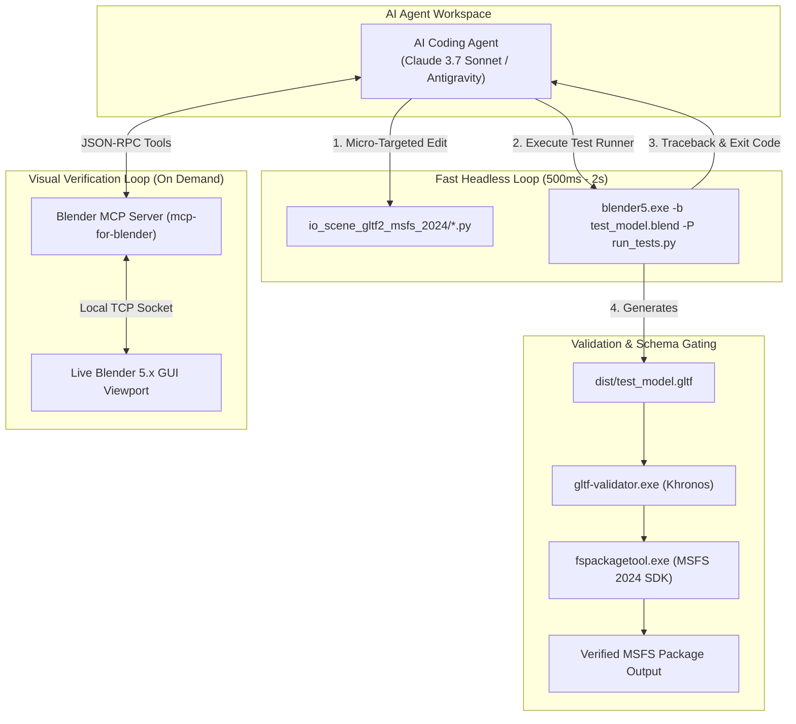
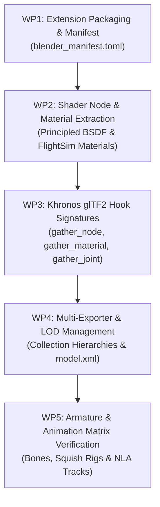

# MSFS 2024 Porting: Blender 5.x Exporter Conversion & Agent Test Harness Architecture

> [!NOTE]
> **Moved here on 20261019** from the FSS aircraft repository (`codes/wasm/doc/journal/`, where the sessions up to the
> move are committed). The add-on repository is now where this work is developed and recorded; repository paths
> without a repository name refer to the repository named in the text (FSS aircraft, E2 testbed `D:\fss-e2`,
> or this one).

- **Issue ID**: N/A
- **Status**: In Progress
- **Related Issues / Regressions**:
  - Root Journal: doc/journal/20261001.msfs2024-porting-strategy-root.md (FSS aircraft repository `codes/wasm/doc/journal/20261001.msfs2024-porting-strategy-root.md`)
  - Sub-journal: doc/journal/20261001.msfs2024-3d-model-lod-attachments-animation.md (FSS aircraft repository `codes/wasm/doc/journal/20261001.msfs2024-3d-model-lod-attachments-animation.md`)

## Session 1: Conversion Strategy, Agent Test Harness & API Adaptation Blueprint

- **Date**: `20261002`
- **Developer**: `uraymeiviar`
- **Agent**: `Antigravity`
- **Branch**: `dev/cfms/Uray`
- **Base Commit SHA**: `6261d6ae53840da4ad6e619057d23d18197de47c (2026-09-30 17:45:47 +0700)`

This document establishes the technical blueprint, rapid test harness architecture, and automated iteration protocol for porting the official Microsoft Flight Simulator 2024 (MSFS 2024) Blender exporter (`io_scene_gltf2_msfs_2024`) from Blender 4.2 LTS to **Blender 5.x**.

---

### 1. Objective & Problem Statement

#### 1.1 Objective
Enable the 3D art team to author, rig, animate, and export Embraer E-Jet assets in **Blender 5.x** while ensuring that exported `.gltf` and `.bin` assets remain 100% compliant with the MSFS 2024 simulation engine and packaging pipeline.

#### 1.2 The Technical Challenge
The official MSFS 2024 exporter (`[MSFS2024_SDK]\Tools\Blender\addons\io_scene_gltf2_msfs_2024`) is strictly certified only up to Blender 4.2/4.5 LTS. Transitioning to Blender 5.x introduces breaking changes across multiple layers:
1. **Blender Extensions Architecture**: Enforcing `blender_manifest.toml` packaging over legacy `bl_info` dictionaries.
2. **Khronos glTF Hook Refactoring**: Blender bundles the upstream Khronos `io_scene_gltf2` export engine. The MSFS plugin hooks into internal extension classes (`gather_node_hook`, `gather_material_hook`, `gather_joint_hook`). Signature changes in upstream Khronos hooks cause immediate Python traceback crashes during export.
3. **Shader Node API Deprecations**: The internal socket naming and input structures of `bpy.types.ShaderNodeBsdfPrincipled` and material node trees continue to evolve, breaking custom FlightSim PBR material extraction.
4. **Silent Matrix Drift Risk**: Subtle quaternion or matrix space transformation bugs between Blender versions can result in corrupted bone rigs, inverted normals, or broken landing gear animations.

---

### 2. High-Speed Agent Test Harness Architecture

To enable an AI agent to diagnose, rewrite, and verify the Python exporter codebase in sub-second feedback loops without manual human intervention, the development environment utilizes a **dual-loop testing harness**:

#### 2.1 The Fast Headless Runner (`run_tests.py`)
The primary driver is a standalone Python test harness executed via Blender's command-line interface in headless background mode:
- Command: `blender5.exe --background tests/test_asset.blend --python tests/run_tests.py`
- Runs in **$\sim 1\text{ second}$**, eliminating GUI overhead.
- If a Python exception or fatal segmentation fault occurs, the process exits cleanly with a non-zero exit code and dumps the full stack trace directly into the agent’s execution context.

#### 2.2 The Interactive Blender MCP Server (`blender-mcp`)
When visual inspection or live scene graph debugging is required:
- Uses the open-source **`ahujasid/mcp-for-blender`** integration.
- A local socket companion addon inside Blender allows the agent to execute real-time queries against Blender 5.x data structures (e.g., inspecting node sockets on active materials or verifying bone constraint matrices).

#### 2.3 Downstream Schema Validation Gate
Clean Python execution is only the first hurdle. The harness enforces two automated downstream verification steps:
1. **Khronos glTF Validator**: Validates that all node hierarchy extensions, animation channels, and buffer views conform to the glTF 2.0 specification.
2. **MSFS Package Tool (`fspackagetool.exe`)**: Validates that the MSFS package compiler processes the glTF and compiles textures to KTX2 without schema errors or warnings.

---

### 3. Technical Surface Area & Migration Tasks

The conversion task is organized into five modular work packages:

#### WP1: Extension Packaging & Manifest
- Transition the addon structure to conform to the Blender 4.2+ and 5.x extension repository format:
  - Generate `blender_manifest.toml` defining addon metadata, permissions, and minimum Blender version (`5.0.0`).
  - Update `__init__.py` registration and unregistration hooks.

#### WP2: Shader Node & Material Extraction (`exporter/material/`)
- Audit `io_scene_gltf2_msfs_2024/exporter/material/` for deprecated node socket queries:
  - Replace hardcoded socket indexing with robust socket identifier lookups (`node.inputs.get("...")`).
  - Adapt to restructured Principled BSDF input sockets (e.g. Metallic, Roughness, Specular, Subsurface).
  - Verify FlightSim material shader presets (Standard, Decal, Windshield, ClearCoat).

#### WP3: Khronos glTF Extension Hooks (`exporter/`)
- Map internal MSFS extension callbacks against the Blender 5.x bundled `io_scene_gltf2` engine:
  - Update `gather_material_hook`, `gather_node_hook`, `gather_texture_hook`, and `gather_joint_hook` parameters.
  - Ensure custom MSFS vendor extension objects (`ASOBO_...` / `MSFS_...`) serialize cleanly into the final JSON chunk.

#### WP4: Multi-Exporter & LOD Management (`multi_exporter/`)
- Adapt the multi-export automation scripts:
  - Verify collection traversal and layer evaluation in the Blender 5.x scene graph.
  - Ensure automated `<LODS>` XML generation correctly records exported glTF relative filenames.

#### WP5: Armature & Animation Transform Verification
- Rigorous verification of armature skinning and animation channels:
  - Ensure bone bind pose matrices, inverse bind matrices, and vertex weights export identically without rotation flipping.
  - Verify NLA track export for flight control surfaces and landing gear linkages.

---

### 4. Verification Test Asset Suite

To ensure comprehensive test coverage, the harness evaluates three dedicated test models:

| Test Asset | Target Subsystem | Verification Criteria |
| :--- | :--- | :--- |
| **`test_pbr_material.blend`** | Material parser & texture flags | FlightSim Standard PBR, Normal map, Comp map (Roughness/Metal/AO), Decal material with alpha channel. |
| **`test_armature_anim.blend`** | Skinning & NLA animations | Rigged gear strut with bones, piston rotation animation, tire squish deform bone. Zero matrix flip. |
| **`test_lods_hierarchy.blend`** | Multi-Exporter & XML generator | 4 LOD collections (`LOD00` through `LOD03`). Correct glTF separation and valid `model.xml` output. |

---

### 5. Implementation Protocol for AI Agents

When executing this conversion task, the agent must adhere to the following sequence:

1. **Sandbox Setup**: Clone `io_scene_gltf2_msfs_2024` to an isolated workspace (`work/blender5-exporter-port/`). Never modify the original SDK installation directly.
2. **Baseline Execution**: Run the headless harness against `test_pbr_material.blend` to capture the first set of Python tracebacks.
3. **Micro-Targeted Refactoring**: Edit specific Python functions addressing one traceback at a time.
4. **Regression Testing**: After resolving individual errors, execute the full test asset suite.
5. **Schema & Compiler Gate**: Run `gltf-validator` on all output files followed by a test build with `fspackagetool.exe`.

---

### 6. Maintainer Review & Dialogue Section

*(This section is reserved for system maintainers and reviewing agents to record design evaluations and milestone approvals.)*

---

## Session 2: Feasibility Probe Results & Blueprint Corrections

- **Date**: `20261002`
- **Developer**: `uraymeiviar`
- **Agent**: `Claude Code (claude-opus-5-5)`
- **Branch**: `dev/cfms/Uray`
- **Base Commit SHA**: `acdba7328b8eec298174b7197611dac1f7cf886b (2026-10-02 13:12:38 +0700)`

### Trigger / Problem Statement

Session 1 was written without inspecting the SDK add-on sources. The objective is also widened: the goal is
not only the glTF exporter but the **complete MSFS 2024 Blender toolset** (`io_scene_gltf2_msfs_2024`,
`lod_tools_msfs_2024`, `wipermask_generator_msfs_2024`, `max_bridge_msfs_2024`, shared `_addons_common`)
running on **Blender 5.2.x LTS**, plus the **MSFS 2020 exporter** (`io_scene_gltf2_msfs_2020` v3.3.2,
reference baseline Blender 3.6.14). A headless feasibility probe was run against Blender 5.2.2 LTS (bundled
Khronos glTF I/O v5.2.40) before committing to a plan.

### Changes Made

#### 1. Probe Results (SDK add-ons v7.4.3, unmodified except where noted)

| Add-on | Blender 5.2.2 Result |
| :--- | :--- |
| `lod_tools_msfs_2024` | Registers cleanly |
| `wipermask_generator_msfs_2024` | Registers cleanly |
| `max_bridge_msfs_2024` | Registers cleanly (`SyntaxWarning` only: non-raw regex in `msfs_2024/usd_export.py:152`) |
| `io_scene_gltf2_msfs_2024` | Fails in `register()`: `ui/exp/export_settings_panel.py:8` imports `io_scene_gltf2.io.com.draco`, relocated to `io_scene_gltf2.io.exp.draco` in Khronos 5.x |

With only that import redirected, the exporter registers and exports. A test scene (MSFS Standard material,
animated armature, animated object, point light) exported with `enable_msfs_extension = True` produced
`ASOBO_normal_map_convention` on the asset, `ASOBO_unique_id` on every node, the Asobo generator string and
both animations. The identical scene exported on Blender 3.6.14 (officially supported) produced the same
JSON structure (same `extensionsUsed`, per-node extensions and animation count; node order differs only).

#### 2. Corrections to Session 1

1. **WP1 (extension manifest) is rejected.** Legacy `bl_info` add-ons still load on 5.2. Converting to
   the Extensions format is harmful: every Asobo add-on imports the top-level package `_addons_common`, which
   breaks under the `bl_ext.<repo>.<name>` namespace that extensions are loaded into.
2. **Module paths in WP2–WP4 do not exist.** Actual locations: glTF hooks `io/exp/gltf_hooks.py`;
   multi-exporter `io/exp/multi_export.py` (operator `msfs2024.multi_export_gltf`); Khronos monkey-patches
   `io/exp/gltf_exporter_patches.py`; materials `blender/material/`; importer `io/imp/msfs_import.py`.
3. **Version support is not "4.2/4.5 only".** `bl_info` declares Blender 3.3+, and the code already carries
   144 `bpy.app.version` gates up to `(4, 5, 0)`. On 5.2 the add-on executes its 4.5 branches, so the
   porting delta is **Khronos glTF I/O 4.5 → 5.2**, not a rewrite.
4. **Hook discovery trap (harness requirement).** Khronos only discovers `glTF2ExportUserExtension` from
   add-ons registered in preferences. Enabling with `addon_utils.enable(..., default_set=False)` exports
   silently **without** any MSFS extension data. Harness runs must use `default_set=True` with
   `--factory-startup`.

#### 3. Revised Risk Ranking

1. **`gltf_exporter_patches.py` (highest)**: replaces Khronos internals (`get_positions`, `get_normals`,
   sampled object/bone channels). Breakage here produces wrong geometry or animation **without** a traceback,
   so verification must diff `.bin` buffer contents numerically, not just JSON structure.
2. Multi-exporter operator path including its subprocess export mode, importer hooks, gizmos, UI panels
   (not exercised headless).
3. Full MSFS material type coverage on real E-Jet assets and `fspackagetool.exe` compilation.

#### 4. Revised Plan

- **Fork**: SDK add-ons are copied to separate fork repositories (MSFS 2024 toolset and MSFS 2020
  exporter, both targeting Blender 5.2.x); the SDK installation stays pristine.
- **Reference baseline**: Blender **4.5.14 LTS** (executes the same 4.5 code branches 5.2 inherits) for
  MSFS 2024; Blender 3.6 is a secondary baseline.
- **Differential harness**: the same scripted test scenes exported on the reference and on 5.2; compare glTF
  JSON (normalized for node order and generator string) and decoded accessor data within float tolerance.

#### 5. MSFS 2020 Exporter Probe (`io_scene_gltf2_msfs_2020` v3.3.2)

On Blender 3.6.14 (reference) the vanilla add-on exports `ASOBO_normal_map_convention`, `ASOBO_unique_id`
and `ASOBO_macro_light`. On Blender 5.2.2 it fails in `register()`: `blender/gizmo.py` imports `bgl`
(removed in Blender 4.0). Usage is confined to six GL state calls in the gizmo draw path, each with a direct
`gpu.state` equivalent. The same `io_scene_gltf2.io.com.draco` relocation is expected to apply next.

### Affected Files

- `doc/journal/20261002.msfs2024-blender5-exporter-conversion.md` (this session)

### Scope & Expected Behavior

Feasibility confirmed: no architectural rewrite is required. Remaining work is a Khronos API delta audit
(4.5 → 5.2 for MSFS 2024, 3.6 → 5.2 for MSFS 2020) driven by the differential harness.

---

## Session 3: Add-on Forks, Production Parity Findings & Unified Add-on Plan

- **Date**: `20261003`
- **Developer**: `uraymeiviar`
- **Agent**: `Claude Code (claude-opus-5-5)`
- **Branch**: `dev/cfms/Uray`
- **Base Commit SHA**: `874b321b4b5f0718efb68f18ee99b8f4799a925d (2026-10-03 07:31:39 +0700)`

### Trigger / Problem Statement

Execute the Session 2 plan: fork the SDK add-ons, make them work on Blender 5.2, and verify them with a
differential harness. During the work it surfaced that the FSS production MSFS 2020 exporter is **not** the
SDK one: it is Asobo `io_scene_gltf2_msfs_2020` **v3.3.1** with FSS edits, plus an edited Khronos
`io_scene_gltf2` (3.6.27), shipped in `tools/blender/3.6`. Target is therefore "same output as production"
for MSFS 2020, while the porting work itself stays off the main pipeline.

### Changes Made

#### 1. Decisions

| Topic | Decision |
| :--- | :--- |
| Production pipeline | `tools/blender` (Blender 3.6) and all `.blend` sources stay unchanged until the MSFS 2024 porting work starts; Blender 5.2 tooling lands later on a forked branch of the FSS repo |
| Forks | Separate repos, kept as references: `github.com/uraymeiviar/msfs2024-blender-addons`, `github.com/uraymeiviar/msfs2020-blender-addons` |
| Unified add-on | New repo `H:\git-repos\msfs-blender-5-addons`; module name `io_scene_gltf2_msfs_fss`; one install exports MSFS 2020 **or** MSFS 2024 via a per-scene target, default **MSFS 2024** |
| MSFS 2020 parity | Follow the `tools/blender` production add-on so exports stay the same; Asobo 3.3.2 *additions* (material `alphaMode`, `ACTIVE` vertex color option) are accepted |
| Reference Blender | 4.5 LTS for both add-ons. Blender 3.6 is a bad reference for MSFS 2020 materials (see Known Issues, item 1) |
| Clickspot helper | Not part of the exporter; becomes a separate FSS add-on later |
| Legacy normals | Cleanup runs inside Blender 5.2 when a pre-4.1 file is first opened, never as a 3.6 pass on the repo |

#### 2. Blender 5.x Breakages Fixed in the Forks

| Defect | Effect | Add-on | Fix |
| :--- | :--- | :--- | :--- |
| Khronos moved `io.com.draco`, dropped `dll_exists()` | Add-on fails to register | 2024, 2020 | Public `io_scene_gltf2.is_draco_available()` (4.5+) |
| `bgl` removed (4.0) | Add-on fails to register | 2020 | `gpu.state` |
| `ShaderNodeSeparateRGB` removed (5.0) | Anisotropic / Hair node tree fails to build | 2024, 2020 | `ShaderNodeSeparateColor` |
| GN modifier inputs no longer ID properties (5.0) | All 2024 collision gizmos and LOD Tools viewer broken | 2024 | `_addons_common.geometry_node_utils.get/set_modifier_input_value()` (typed RNA, menu socket int mapping) |
| `enable_msfs_extension` update callbacks sync each other forever | Ticking the checkbox crashes Blender 5.2 (stack overflow) | 2020 | Write only on change |

#### 3. MSFS 2020 Production Parity Work

- **FSS edits identified** (diffed against Asobo GitHub tags v3.3.1 / v3.3.2):
  1. `io/msfs_material.py` texture cache workaround (commit `3d9a6651e`).
  2. Edited Khronos `gltf2_blender_gather_primitives_extract.py`: `need_neutral_bone = False`.
  3. `Create Clickspot Helper` operator (commit `d9c5e60d8`), removed with the legacy alias in `5ba5c9fd9`.
- **Texture cache bug (root cause)**: Khronos 3.6 memoizes texture gathering (`__gather_texture_info_helper`,
  `gather_texture`, `gather_image`, `__get_tex_from_socket`, `gather_sampler`) keyed on socket/node objects.
  The exporter's throwaway nodes are freed and their address reused, so the previous texture is returned.
  The production workaround clears only the first cache; on 3.6 the harness still shows 22 stale texture
  references. The fork keeps temp nodes alive until export end instead (all keys distinct, caches valid).
  Not reproducible on Khronos 4.2+.
- **Neutral bone**: reproduced in the fork at runtime (`io/msfs_khronos_patches.py`), MSFS extension only.
- **Base color through Mix nodes**: Khronos 4.5+ follows Mix/Math nodes from Principled Base Color/Alpha and
  exported the windshield detail map as `baseColorTexture`, renaming the real detail image to
  `GLASS_COMP-1.png`. Fixed in the same patch module: an MSFS material with an empty
  `msfs_base_color_texture` exports no base color texture.

#### 4. Cockpit Benchmark (`assets/visual/cockpit/Cockpit.blend`, E195)

Production export (`scripts/export-blend-to-gltf.py` on `tools/blender`) reproduces the committed
`E195-Cockpit-LOD00.gltf` exactly. Blender 5.2 + MSFS 2020 fork now matches it on all 2,381 nodes,
geometry positions/UVs/topology, all materials and textures, and all animations, except:
legacy normals (Known Issues, item 3) and the accepted Asobo 3.3.2 `alphaMode` addition (20 materials).

The 5.2 export script needs two argument changes versus `export-blend-to-gltf.py`:

| 3.6 argument | Blender 5.2 equivalent | Why |
| :--- | :--- | :--- |
| `export_colors=True` | `export_vertex_color="ACTIVE"` | Option replaced in Khronos 4.2 |
| (none) | `export_merge_animation="NLA_TRACK"` | Default `ACTION` merges animations sharing an action: 503 animations became 82 |

#### 5. Test Harness (in each fork, `tests/`)

Exports procedurally built scenes (all material types, skinning incl. unweighted vertices + NLA animation,
hierarchy, lights, gizmos, vertex data) on a reference and a target Blender, with and without the MSFS
extension, and semantically diffs glTF / model XML / texture XML output. It also fails on Python tracebacks,
MSFS logger errors, and temp nodes left in materials. Both forks: Blender 5.2 output identical to 4.5 for
all cases.

### Known Issues

1. **Production 3.6 exports stale textures nondeterministically** (texture cache, section 3). Current
   production exports may carry wrong texture references; the fork fix is not back-ported to
   `tools/blender`.
2. **Two add-ons cannot be enabled together**: the 2024 add-on re-registers all 86 MSFS 2020 properties
   (same names, different `msfs_material_type` items, e.g. `geo_decal`/`decal`, `parallax`/`parallax_window`)
   and disabling either deletes the shared properties. This is the motivation for the unified add-on.
3. **Legacy normals differ on Blender 4.1+**. With Auto Smooth off, 3.6 ignores sharp edges, custom normals
   and Weighted Normal modifiers; 4.1+ always applies them. Detection in 5.2 is solved: a `.blend` DNA
   reader recovers the pre-4.1 per-mesh Auto Smooth flag (validated on all 812 Cockpit meshes, works on
   zstd-compressed files). Cleanup on Auto-Smooth-off meshes (remove sharp edges, Weighted Normal modifiers,
   custom normals) brings Cockpit from 48 to 13 meshes off by >= 10 deg; still open: 60 meshes off by < 10 deg
   (shared custom-normal knob meshes, suspected custom normal re-encoding) and 13 meshes with Auto Smooth on
   (suspected Smooth by Angle conversion).
4. **Production `export-blend-to-gltf.py` is 3.6-only** (`export_colors`), see section 4.

### Updated Plan

1. Build the unified add-on `io_scene_gltf2_msfs_fss` (2024 toolset as data model and UI, per-scene export
   target, MSFS 2020 export hooks + Khronos patches, material type translation layer for 2020 targets).
2. Move the harness into the unified repo, covering both targets; acceptance test: target MSFS 2020 exports
   `Cockpit.blend` identically to the MSFS 2020 fork.
3. Legacy normals migration tool in the unified add-on: detect on open, preview, apply; resolve the
   remaining Known Issue 3 cases first.
4. Extend coverage: importer, Wiper Mask generator, 3ds Max bridge, UI panels (manual session), more asset
   benchmarks (exterior, cabin), `fspackagetool.exe` build.
5. At porting start: fork the FSS repo branch, add Blender 5.2 tooling and the 5.2 export script.

### Affected Files

- `doc/journal/20261002.msfs2024-blender5-exporter-conversion.md` (this session)

### Scope & Expected Behavior

No change to the FSS repo pipeline. All add-on work lives in the external repos listed above.

---

## Session 4: Unified Add-on `io_scene_gltf2_msfs_fss` & Session 3 Corrections

- **Date**: `20261003`
- **Developer**: `uraymeiviar`
- **Agent**: `Claude Code (claude-opus-5-5)`
- **Branch**: `dev/cfms/Uray`
- **Base Commit SHA**: `874b321b4b5f0718efb68f18ee99b8f4799a925d (2026-10-03 07:31:39 +0700)`

### Trigger / Problem Statement

Build the unified add-on (Session 3, Updated Plan item 1): one Blender 5.2 install that exports glTF for
MSFS 2020 and MSFS 2024 from the same `.blend`, chosen per scene. Also corrects two Session 3 claims.

### Corrections to Session 3

| Session 3 (Known Issues, item 2) | Measured (each add-on enabled alone) |
| :--- | :--- |
| The 2024 add-on re-registers all 86 MSFS 2020 properties | 60 shared; 26 exist only in MSFS 2020 (legacy gizmo, object level light settings, wiper states, dirt / extra slot textures, glass and parallax values, 2020 scene export settings) |
| Only `msfs_material_type` differs | 9 shared properties differ: material type items, defaults (`msfs_emissive_scale` 1.0 vs 1000, parallax room size 1.0 vs 0.5, `msfs_detail_blend_threshold` 0.1 vs 0.001), ranges (`msfs_ghost_bias` / `msfs_ghost_power` swapped, `msfs_uv_tiling_*`) |

Additional finding: on load, the 2024 add-on converts MSFS 2020 data automatically and one way
(`scene_loading.prepare_scenes`: gizmo empties replaced by geometry nodes gizmos, all material node trees
rebuilt as 2024 graphs; gizmos also replaced after Append).

### Changes Made

Repository `H:\git-repos\msfs-blender-5-addons` (remote `github.com/uraymeiviar/msfs-blender-5-addons`), built
on the MSFS 2024 fork:

1. **Data model**: MSFS 2024 properties plus the 26 MSFS 2020-only ones. The vendored MSFS 2020 code
   (`_msfs2020/`, no `__init__.py`, invisible to Asobo's auto registration) registered properties as an import
   side effect; those statements now fill a definitions table. A compatibility view gives the MSFS 2020
   export code MSFS 2020 material type names and MSFS 2020 defaults (float32 exact) for unset values.
2. **Export target** `Scene.msfs_fss_export_target` (default MSFS 2024); scenes carrying stored MSFS 2020 data
   are detected as MSFS 2020 on load. Khronos user extension dispatches to the 2024 or 2020 hooks.
3. **No automatic conversion**: Asobo's gizmo replacement (load, Append) is off; node graph rebuild on load,
   default white color attribute, and Asobo's Khronos patches are limited to MSFS 2024 scenes / exports.
4. **Node tree independence**: an MSFS 2020 export gives materials carrying the 2024 preview tree the tree
   the MSFS 2020 add-on builds from the same properties, then remaps users back to an untouched copy (a rebuild
   would change the artist's tree, Asobo's incremental updates are edit-order dependent).
5. **One file, both simulators**: `Object.msfs_fss_export_only` filter (Khronos `gather_tree_filter_tag_hook`);
   each target skips the other's gizmo representation; **Prepare for MSFS 2024** adds 2024 gizmos and street
   lights next to the legacy ones without replacing anything.
6. **UI**: export target in the 3D View sidebar and glTF export dialog; MSFS 2020 object / material panels.

### Verification

- Harness, Blender 5.2: unified MSFS 2024 output identical to the MSFS 2024 fork, unified MSFS 2020 output
  identical to the MSFS 2020 fork, all cases; exports leave every material node tree unchanged.
- `Cockpit.blend` (E195), target MSFS 2020: identical to the MSFS 2020 fork; detected as MSFS 2020 on load.
- Prepare for MSFS 2024: MSFS 2020 export identical before and after; MSFS 2024 export contains the new gizmo
  (road collider tag kept) and street light, not the legacy objects.

### Known Issues

1. **Same property, different meaning per simulator**: `msfs_emissive_scale` (MSFS 2024: `emissiveFactor =
   color x scale`, default 1000; MSFS 2020: 1.0-based strength). Choosing a material type in the unified add-on
   writes the 2024 value, so MSFS 2024-authored materials export 1000x too bright for MSFS 2020. Needs a
   maintainer decision: per-simulator value or a defined conversion.
2. The 2024 material type callback fails for some types when alpha mode is set to Blend (no alpha group in
   that type's 2024 tree); Asobo behaviour, the UI does not offer the combination.
3. Panels verified to register; drawing not yet checked in an interactive session.
4. Legacy normals migration tool still open (Session 3, Known Issue 3).

### Affected Files

- `doc/journal/20261002.msfs2024-blender5-exporter-conversion.md` (this session)

### Scope & Expected Behavior

No change to the FSS repo pipeline; production stays on `tools/blender` (Blender 3.6).

## Session 5: Material Meaning, Legacy Normals, First MSFS 2024 Cockpit & Portable Blender 5.2

- **Date**: `20261007`
- **Developer**: `uraymeiviar`
- **Agent**: `Claude Code (claude-opus-5-5)`
- **Branch**: `dev/fs24/uray`
- **Base Commit SHA**: `52940edeff600fba7639c41d07d3af14224bac72 (2026-10-07 20:59:53 +0700)`

### Trigger / Problem Statement

Close the Session 4 known issues, export the first MSFS 2024 model with the unified add-on (E195 cockpit, which
was very dim in MSFS 2024 with the MSFS 2020 glTF) and replace the production Blender 3.6 in `tools/blender` by a
portable Blender 5.2 that artists can use, not only the deploy scripts.

### Decisions

1. **Material values have MSFS 2024 meaning in the .blend** (Session 4, Known Issue 1). `msfs_emissive_scale` is
   a brightness in cd/m2; MSFS 2020 exports divide it by `Scene.msfs_fss_msfs2020_emissive_reference` (default
   1000 cd/m2 = 1.0), set in the export dialog and the Export Target panel.
2. **MSFS 2020 materials are migrated once** (on load, after Append and before any export): values whose default
   differs are stored with the MSFS 2020 default, the emissive scale is multiplied by the reference, the MSFS
   2024 preview graph is rebuilt without changing stored values, the material is marked migrated.
3. **Legacy normals** (Session 3, Known Issue 3): Blender 4.1 removed Auto Smooth, so meshes saved by Blender 3.6
   with Auto Smooth off shade differently in 5.2. The add-on reads each mesh's saved flag from the .blend on disk
   and offers *Restore Blender 3.6 Normals* (custom normals, Weighted Normal modifiers removed). The maintainer
   keeps the Blender 3.6 look: the deploy restores normals in memory for files last saved by Blender 4.0 or
   older; converting the .blend files to 5.2 is a later, separate step.
4. **Portable Blender 5.2 in `tools/blender`**: Blender 3.6 stays only as a local, git-ignored backup
   `tools/blender-3.6/` until the migration is finished.
   - Blender 4.2+ is portable through a `portable/` folder next to `blender.exe`, no longer through
     `<version>/config`. Its content (preferences, recent files, user add-ons) is git-ignored and local to each
     PC; only `portable/README.txt` is tracked so the folder exists after a clone.
   - Blender 5.2 does not scan `5.2/scripts/addons`; the MSFS add-ons are in `5.2/scripts/addons_core`, next to
     Blender's own, so artist-installed add-ons never mix with them.
   - `5.2/scripts/startup/fss_enable_addons.py` enables the MSFS add-ons from a `load_post` handler: Blender
     applies the preference add-on list after startup scripts run, which would disable them again.
   - Removed to keep the size down: `blender.pdb` (debug symbols) and `datafiles/locale` (translations; US
     English is built in). 788 MB.
   - Not included: the 3ds Max bridge add-on (not used).
5. **Deploy target**: one set of `.bat` files for both simulators, target passed as an argument (no environment
   variable); without an argument MSFS 2024 into `msfs24-projects`, `fs20` into `msfs-projects` (next commit).
6. **MSFS 2024 texture metadata**: MSFS 2024 SimObjects use `<texture>.png.xml` (`BitmapSlot`, `UserFlags`),
   `.FLAGS` only applies to MaterialLib textures. The XML belongs to `msfs24-projects`, never to `assets/`
   (platform-agnostic sources), and keeps the `.FLAGS` quality flags. The exporter's own *Generate TextureLib* is
   off for deploys: it writes next to the source textures and without the flags. Generation is a follow-up.

### Changes Made

Add-on repository `github.com/uraymeiviar/msfs-blender-5-addons`:

- `4261d2d`, `4131499`: MSFS 2024 meaning, one-time migration, emissive reference.
- `9182c6c`, `179cc76`: export target detection (MSFS 2020 evidence decides an unset target, cache cleared on
  file load).
- `afbd923`: Restore Blender 3.6 Normals.
- `f7beb53`: the migration graph rebuild dropped `msfs_decal_mode`, an MSFS 2024-only value the decal builder
  sets, so migrated decals exported without `ASOBO_material_geometry_decal` (z-fighting on cockpit labels).
  Only values MSFS 2020 reads are unset again after a rebuild.
- `1c6fe6d`: *Merge Animation* export setting passed to the glTF exporter; Actions mode merged animations by
  action (Khronos default: 82 instead of 503 cockpit animations).

FSS repository:

- `tools/blender`: Blender 5.2.2 LTS replaces Blender 3.6, with the add-ons of `1c6fe6d`
  (`FSS-ADDONS-VERSION.txt`).
- `.gitignore`: `tools/blender/portable/*` (except `README.txt`) and `tools/blender-3.6/`.

### Verification

- E195 cockpit exported for MSFS 2024 through Asobo's multi-exporter (PRESETS mode, visible objects as for the
  MSFS 2020 deploy, Actions mode without sampling, one animation per NLA track, not clipped to the playback
  range), tested in MSFS 2024 by the maintainer: displays at full brightness (`emissiveFactor` 1000 cd/m2
  instead of 1.0), yoke, pedals, levers, dials and buttons animate, no z-fighting on panel labels.
- Same 2,381 nodes and 503 animations as the MSFS 2020 export; 7 decal materials with the MSFS 2020 blend
  factors. Add-on harness: 0 differences for MSFS 2020 and MSFS 2024 after each fix.
- `tools/blender`: preferences resolve to `tools/blender/portable`, the MSFS add-ons load from
  `tools/blender/5.2/scripts/addons_core` with and without a .blend; interactive start not yet checked.

### Known Issues

1. **Yoke actions lie outside the playback range** (frames 100-200, strips at 0-100): the MSFS 2024 default
   *Limit to Playback Range* left one key per channel (yoke frozen). Deploys export with it off.
2. **NLA tweak mode**: `CHECKLIST_PAPER` and `EMPTY_FCMODE_ELV_COVER` are saved in NLA tweak mode, which the NLA
   track export cannot handle; the deploy leaves tweak mode in memory. A pre-export check in the add-on is open.
3. **Glass back faces culled in MSFS 2024** (`MAT_SCREEN_GLASS`, `windshield`): single-sided in both exports,
   MSFS 2020 apparently drew glass from both sides. Deferred.
4. **Cockpit lights** (glareshield, reading, dome) have no effect in MSFS 2024; likely the MSFS 2024 light
   configuration, not the model. Deferred.
5. Until the deploy script commit, the deploy `.bat` files run Blender 5.2 with the Blender 3.6 export script.

### Affected Files

- `tools/blender/**` (Blender 5.2.2, replaces Blender 3.6)
- `.gitignore`
- `codes/wasm/doc/journal/20261002.msfs2024-blender5-exporter-conversion.md` (this session)

### Scope & Expected Behavior

Artists open `tools/blender/blender.exe` and get Blender 5.2 with the MSFS add-ons enabled; their preferences stay
on their PC. Deploys are broken until the export script and `.bat` files are updated in the next commit.

## Session 6: MSFS 2024 Deploy Through the .bat Chain & E195 Sim Tests

- **Date**: `20261007`
- **Developer**: `uraymeiviar`
- **Agent**: `Claude Code (claude-opus-5-5)`
- **Branch**: `dev/fs24/uray`
- **Base Commit SHA**: `6c7d1ab8f010534d2e70ed446aae45eccf0f34b6 (2026-10-07 21:54:31 +0700)`

### Trigger / Problem Statement

Make the asset deploy scripts export MSFS 2024 glTF with the portable Blender 5.2 (Session 5) while keeping the
MSFS 2020 deploy, and verify the result in MSFS 2024 on the E195.

### Decisions

1. **Target per run, no environment variable**: every deploy `.bat` passes its first argument on; the shared
   scripts take it as their last argument. No argument or `fs24`: MSFS 2024 into `msfs24-projects`; `fs20`: MSFS
   2020 into `msfs-projects`; anything else stops with an error. `assets/visual/deploy-fs20.bat` runs the full
   MSFS 2020 deploy. Livery aggregators keep the target in `DEPLOY_TARGET`, because `%1` inside their
   subroutines is the livery name. Temporary files go to `deploy-temp\<target>\`.
2. **fs24 export settings** (`scripts/export-blend-to-gltf.py`, Asobo multi-exporter, PRESETS mode with the
   visible objects as the fs20 export): modifiers applied, keyframes as authored, one animation per NLA track,
   not limited to the playback range, texture file names only (textures are deployed into the package's texture
   folders), no texture XML next to the source textures, NLA tweak mode left in memory.
3. **Normals**: Blender 3.6 normals are restored in memory for files last saved by Blender 4.0 or older, so the
   sim keeps the current look until the .blend files are converted.
4. **Emissive reference** is a project calibration, not an export option: the add-on preference *MSFS 2020
   Emissive Reference* (add-on `d7afeb7`) is used by scenes without their own value; migration stores the value
   it used in the scene. The portable Blender's startup script sets it to 3000 cd/m2, for deploys and for artists
   opening unconverted files alike. MSFS 2020 output is unchanged (migration multiplies, export divides by the
   same value).

### Changes Made

- `scripts/export-blend-to-gltf.py`: deleted by mistake in `9493cdbd0` (with the test scripts; every deploy
  failed since 2026-10-06); recreated for Blender 5.2 with the target argument. The Blender 3.6 version was
  restored unchanged on `dev/cfms/Uray` (`ba767cdc4`, pushed).
- `scripts/deploy-gltf.bat`, `deploy-livery-gltf.bat`, `deploy-default-livery-gltf.bat`: target argument,
  projects folder per target, target printed with every deploy.
- 187 `.bat` files under `assets/visual/` pass the target on; the 7 texture scripts copy into the target's
  projects folder; new `assets/visual/deploy-fs20.bat`.
- `tools/blender`: add-ons updated to `d7afeb7`; `fss_enable_addons.py` sets the emissive reference.

### Verification

- E195 deployed for fs24 (cockpit, exterior, wings, FSS livery) and tested in MSFS 2024 by the maintainer: looks
  as in MSFS 2020; yoke, decals and glass correct; displays brighter but still not bright enough at midday (to be
  tuned in the display code).
- Found and fixed during the sim tests:
  - Modifiers were not applied (MSFS 2024 exporter default): Blender 5 keeps Auto Smooth as a modifier (617
    cockpit objects, plus 221 Weighted Normal and 2 Solidify modifiers), so buttons and the EFB bezel looked
    rounded, spoilers showed a pattern and glass back faces were missing.
  - Texture URIs pointed into `assets/` instead of file names.
  - The emissive reference set in the export script came too late: materials are migrated on file load, before
    the script runs.
- fs20 deploy of the E195 cockpit: 2,381 nodes and 503 animations as the committed Blender 3.6 export; emissive
  1.0; the trim switch normals are identical to Blender 3.6.

### Known Issues

1. **Mesh sharing**: Blender 5.2's glTF exporter does not share mesh data between objects with modifiers (55
   cockpit buttons share one mesh): cockpit 1,121 meshes instead of 908, `.bin` +8% (29.2 to 31.6 MB), for both
   targets. Same geometry and look.
2. `MAT_LIVERY` (`E195-FSS-Livery.blend`) has *Use Pearl Effect* set; only the MSFS 2024 export writes it (the
   material is a decal). No visible difference in the sim test.
3. Blender 5.2 reports 5 EFB meshes as invalid (`EFB_HINGE_CLAMP_MESH.001`, `EFB.005` to `EFB.008`); no visible
   difference in the sim test.
4. Exterior glass appears only at close range (LOD), not yet analysed.
5. Cockpit lights (glareshield, reading, dome) have no effect in MSFS 2024 (Session 5, Known Issue 4).
6. MSFS 2024 texture XML (`<texture>.png.xml` with slot and `.FLAGS` quality flags) in `msfs24-projects` is not
   generated by the deploy yet; `.FLAGS` are still copied.
7. NLA tweak mode check in the add-on still open (Session 5, Known Issue 2).

### Affected Files

- `scripts/export-blend-to-gltf.py`
- `scripts/deploy-gltf.bat`, `scripts/deploy-livery-gltf.bat`, `scripts/deploy-default-livery-gltf.bat`
- `assets/visual/**/*.bat` (187 changed, `deploy-fs20.bat` new)
- `tools/blender/5.2/scripts/addons_core/io_scene_gltf2_msfs_fss/**` (4 files),
  `tools/blender/5.2/scripts/startup/fss_enable_addons.py`, `tools/blender/FSS-ADDONS-VERSION.txt`
- `codes/wasm/doc/journal/20261002.msfs2024-blender5-exporter-conversion.md` (this session)

### Scope & Expected Behavior

Double-clicking any deploy `.bat` deploys MSFS 2024 into `msfs24-projects`; `fs20` as argument (or
`deploy-fs20.bat`) deploys MSFS 2020 into `msfs-projects` with the same content as before, exported by Blender
5.2.

## Session 7: MSFS 2024 Texture XML From the MSFS 2020 .FLAGS

- **Date**: `20261008`
- **Developer**: `uraymeiviar`
- **Agent**: `Claude Code (claude-opus-5-5)`
- **Branch**: `dev/fs24/uray`
- **Base Commit SHA**: `f014e441a0b3d76243813f5f675393a0735e50d8 (2026-10-07 23:44:29 +0700)`

### Trigger / Problem Statement

MSFS 2024 SimObjects read texture compression flags from `<texture>.xml` (`BitmapSlot`, `UserFlags`), not from
the MSFS 2020 `<texture>.FLAGS` (SDK: `.FLAGS` only for MaterialLib textures). The texture deploy copies `.FLAGS`;
the quality flags must reach the MSFS 2024 package without reducing texture quality.

### Findings

- The existing `.png.xml` files in `msfs24-projects` were written by the MSFS 2024 project upgrade ("upgrade all"
  when opening the MSFS 2020 project package in MSFS 2024). All 118 `.FLAGS` that had an XML matched its
  `UserFlags`; slots matched the MSFS 2024 exporter's TextureLib derivation for 58 of 59 textures used by MSFS
  2024 models (`Frost_Detail_norm`: `DETAILNORMAL` vs `ADD_NORMAL`, both SDK detail normal slots). Some files
  carry `ForceNoAlpha`, decided by MSFS.
- The exporter's own *Generate TextureLib* writes next to the source textures, single-line and without the
  `.FLAGS` flags; not used (off for deploys, Session 6).

### Decisions

1. Maintainer rule: the `.FLAGS` value goes into the XML; what the MSFS 2024 upgrade wrote stays. Per texture with
   a `.FLAGS` file: an existing XML gets `UserFlags` set and nothing else changed; a missing XML is created with
   the slot derived from the material that uses the texture in the package's models (TextureLib), or left
   alone if no model uses it. The `.FLAGS` file is removed once its value is in the XML. Textures without
   `.FLAGS` are never touched (no new XML, no slot or `ForceNoAlpha` change).
2. Generated per package at the end of the fs24 texture deploy, after the models; the texture deploy keeps
   copying `.FLAGS` as the source of the flags.
3. Not included: the GPU cart package (`fss-simobjects-vehicles-gpu`), until its model deploy is checked.

### Changes Made

- `scripts/generate-texture-xml.py` (new): runs with the portable Blender (`-b --python ... -- <package>`),
  `--check` reports without writing; output lines tagged `[texture-xml]`.
- `assets/visual/textures/textures-*/deploy-textures.bat` (6): fs24 only, runs the generator for the package,
  log in `deploy-temp\texture-xml-<package>.log.txt`.

### Verification

- E195 package (`msfs24-projects/fss-aircraft-e195`): all 245 XML files byte-identical before and after;
  59 `.FLAGS` removed (value already in the XML), 82 textures without `.FLAGS` untouched, 8 textures with `.FLAGS`
  but no XML and no model using them left as they are.

### Known Issues

1. Orphan `.FLAGS` without a texture in the E195 package and the asset sources: `COCKPIT_STD_EMIS.png.FLAGS` (no
   such texture) and `Rear_cockpit_EMIS.FLAGS` (name without `.png`).
2. Slots for new XML come from the deployed models; before a full fs24 deploy some models are still MSFS 2020
   glTF (core slots are the same, detail and windshield slots may not be).
3. The texture deploy integration has not run end to end yet (generator tested directly).

### Affected Files

- `scripts/generate-texture-xml.py`
- `assets/visual/textures/textures-*/deploy-textures.bat` (6)
- `codes/wasm/doc/journal/20261002.msfs2024-blender5-exporter-conversion.md` (this session)

### Scope & Expected Behavior

An fs24 texture deploy leaves each package with MSFS 2024 texture XML carrying the MSFS 2020 quality flags and no
`.FLAGS` files for textures the XML covers; MSFS 2020 deploys are unchanged.

## Session 8: Duplicate Animation in MSFS 2024 Freighter Cabins

- **Date**: `20261008`
- **Developer**: `uraymeiviar`
- **Agent**: `Claude Code (claude-opus-5-5)`
- **Branch**: `dev/fs24/uray`
- **Base Commit SHA**: `77edc2a903d87e2c453da8f20c2d87ce07df142e (2026-10-08 00:53:54 +0700)`

### Trigger / Problem Statement

The MSFS 2024 package build of both freighters failed after the full fs24 deploy (Session 7): the GLTFValidator
rejected `E190F-Cabin-LOD00.gltf` and `E195F-Cabin-LOD00.gltf` with *Duplicate animation name: 'main_cargo_door'*.

### Root Cause

An exporter defect, not a content error. In `E19xF-Cabin.blend`, `CabinArmature` has `main_cargo_door` as its
active action and as an NLA track (a legal setup: Blender 3.6 and the fs20 export write it once, 6 animations).
The MSFS 2024 multi-exporter exports duplicates of the objects: Blender copies their actions, and Asobo's
`duplicate_selected_objects` put back only the original active action. The duplicate's active action and its NLA
strip were then two different actions (`main_cargo_door`, `main_cargo_door.001`) and both were exported under the
track name.

### Changes Made

- Unified add-on `9cc6f65`: Blender's *Duplicate Data: Action* preference is off while the multi-exporter
  duplicates (restored afterwards), so duplicates use the source's actions in NLA strips as well as for the active
  action; Asobo's active-action reassignment is no longer needed. Duplicates now share strip actions with the
  originals as they already shared the active action.
- `tools/blender`: add-on file updated, `FSS-ADDONS-VERSION.txt` at `9cc6f65`.

### Verification

- Freighter cabins redeployed for fs24: 6 animations each; no glTF in `msfs24-projects` has duplicate animation
  names. Add-on harness: 0 differences for MSFS 2020 and MSFS 2024.
- E195 cockpit: `.gltf` byte-identical to the previous export; `.bin` differs in 2 UV values of equal value, as
  between two runs of the same exporter version (the export is not fully deterministic, likely signed zeros).

### Known Issues

1. The MSFS 2024 package build of the freighters still needs to be re-run by the maintainer.

### Affected Files

- `tools/blender/5.2/scripts/addons_core/io_scene_gltf2_msfs_fss/io/exp/multi_export.py`
- `tools/blender/FSS-ADDONS-VERSION.txt`
- `codes/wasm/doc/journal/20261002.msfs2024-blender5-exporter-conversion.md` (this session)

### Scope & Expected Behavior

Objects whose active action is also in an NLA track export each animation once for MSFS 2024, as for MSFS 2020.

## Session 9: Full MSFS 2020 Redeploy, Object Materials & Pose Mode Pairing

- **Date**: `20261008`
- **Developer**: `uraymeiviar`
- **Agent**: `Claude Code (claude-opus-5-5)`
- **Branch**: `dev/fs24/uray`
- **Base Commit SHA**: `e8bcfb51121c173113c4b88d59f8b7bad4d9cea2 (2026-10-08 02:41:25 +0700)`

### Trigger / Problem Statement

Verify that a full MSFS 2020 redeploy (`assets/visual/deploy-fs20.bat`) with Blender 5.2 still produces the
committed MSFS 2020 models, and compare the MSFS 2024 deploy against them node by node.

### Findings

1. **Full MSFS 2020 deploy**: 190 models, 0 failures, same node and animation names as the committed exports.
2. **Object-linked materials lost** (both targets, 9 objects in 6 files: E175 exterior rivets, E190 Kenya and
   Tianjin liveries, E190F DHL and TNT liveries, E190F cabin handle): with modifiers applied, the glTF exporter
   takes the materials of the evaluated mesh, which only carries the mesh data's materials. Blender 3.6 exported
   these objects without modifiers; Blender 5 turns Auto Smooth into a modifier.
3. **Wrong node names in MSFS 2024** (E175 Delta livery, 23 nodes holding another object's mesh, e.g. the rudder
   tab node with the fuselage): `Armature` was saved in Pose mode; the duplicate operator skips objects in Pose or
   Edit mode although selected, and Asobo's multi-exporter paired sources and duplicates by list order.
4. Not defects: skinned meshes keep their own transform in MSFS 2024 exports (Asobo position handling; glTF ignores
   skinned mesh node transforms); invisible collider materials export emissive 0 instead of 0.8 (never rendered).
5. **Instancing**: with *Apply Modifiers* (needed for Solidify, Weighted Normal), every object with a modifier gets
   its own glTF mesh even when it shares mesh data. Blender 3.6 did the same, but the objects had no modifier;
   the Auto Smooth modifier added by Blender 5 ends instancing (cockpit `.bin` +8%, E190/E195 cabin x2.1).

### Changes Made

- Unified add-on `ad905eb`: when modifiers are applied, object-linked slots keep the object's material (the mesh
  data gets it for that object's export only).
- Unified add-on `ea05bbff`: the multi-exporter switches selected objects to Object mode before duplicating, pairs
  duplicates with their source by a temporary tag instead of list order, and stops the export if an object was not
  duplicated.
- `tools/blender`: both files updated, `FSS-ADDONS-VERSION.txt` at `ea05bbff`.

### Verification

- MSFS 2020 (`msfs-projects`, uncommitted test deploy): all 190 models have the committed material on every node.
- MSFS 2024: the 6 files with object-linked materials and the Delta livery redeployed; Delta matches the committed
  MSFS 2020 model on all 239 nodes (material and vertex count per node); no other file shows shifted node names.
- Add-on harness: 0 differences for MSFS 2020 and MSFS 2024.

### Known Issues

1. Instancing lost through the Auto Smooth modifier (Finding 5); fix proposed separately.
2. Editor states saved in .blend files (Pose mode, NLA tweak mode) are handled by the exporter or the deploy
   script; artist documentation still to write.

### Affected Files

- `tools/blender/5.2/scripts/addons_core/io_scene_gltf2_msfs_fss/io/exp/gltf_exporter_patches.py`
- `tools/blender/5.2/scripts/addons_core/io_scene_gltf2_msfs_fss/io/exp/multi_export.py`
- `tools/blender/FSS-ADDONS-VERSION.txt`
- `codes/wasm/doc/journal/20261002.msfs2024-blender5-exporter-conversion.md` (this session)

### Scope & Expected Behavior

MSFS 2020 deploys with Blender 5.2 give the committed models (except mesh instancing); MSFS 2024 deploys keep node
names and object materials as authored.

## Session 10: Material Property Animations

- **Date**: `20261008`
- **Developer**: `uraymeiviar`
- **Agent**: `Claude Code (claude-opus-5-5)`
- **Branch**: `dev/fs24/uray`
- **Base Commit SHA**: `d87f906c8800d134678ec49cb0e32ce56ed9d935 (2026-10-08 03:22:30 +0700)`

### Trigger / Problem Statement

A DevSupport report (Asobo exporter 8.4.0, SDK 1.8.0) states that material property animations
(`ASOBO_property_animation`, e.g. a wiper material state) are silently dropped on Blender 5.2. The maintainer wants
material property animations supported. No FSS model uses them yet (none in the committed MSFS 2020 models or the
MSFS 2024 deploy).

### Root Cause

1. The same defect exists in the unified add-on (Asobo 7.4.3 base): Khronos' `gather_accessor` gained a
   `normalized` parameter in Blender 5; the positional call raised a TypeError inside the export hook, which the
   exporter swallows.
2. With the deploy's Actions mode without forced sampling, the material animation is appended to a placeholder
   animation on the object, which has no channels and is dropped by Khronos (Asobo keeps it with a forced scale
   channel that only applies to sampled channels).
3. Actions mode with an object whose active action already has the animation name (one action with object and
   material slots): the add-on cached an unset action and the material animation was dropped.

### Changes Made

- Unified add-on `dcfaa44`: input accessor built directly, as the output accessor.
- Unified add-on `436af38`: placeholders get a constant scale key when sampling is off; the active action is used
  when it already has the animation name.
- `tools/blender`: add-on file updated, `FSS-ADDONS-VERSION.txt` at `436af38`.

### Verification

- Test scenes exported with the deploy settings (Actions mode, no sampling): material action alone, NLA track
  (NLA Tracks mode), and one action animating object and material; each exports `ASOBO_property_animation` with the
  keyed values (base color red to green on `materials/0/pbrMetallicRoughness/baseColorFactor`).
- E195 cockpit: same material on every node as the committed MSFS 2020 model; `Cockpit_STD` is now listed once
  (previous MSFS 2024 exports listed it twice). Add-on harness: 0 differences for MSFS 2020 and MSFS 2024.

### Known Issues

1. Material animations need the material action named after (or shared with) the object animation they belong to.
2. Next: merge the newer Asobo exporter (8.4.0, SDK 1.8.0), then NLA tweak mode handling and automatic instancing
   in the add-on.

### Affected Files

- `tools/blender/5.2/scripts/addons_core/io_scene_gltf2_msfs_fss/io/com/extensions/asobo_property_animation.py`
- `tools/blender/FSS-ADDONS-VERSION.txt`
- `codes/wasm/doc/journal/20261002.msfs2024-blender5-exporter-conversion.md` (this session)

### Scope & Expected Behavior

Material property animations keyed on materials are exported for MSFS 2024 with the FSS deploy settings.

## Session 11: Wing Shading in MSFS 2020 (Auto Smooth Modifier Order)

- **Date**: `20261008`
- **Developer**: `uraymeiviar`
- **Agent**: `Claude Code (claude-opus-5-5)`
- **Branch**: `dev/fs24/uray`
- **Base Commit SHA**: `b645a5c2e3ab1e793b7d8d50d5229a260d6daa8b (2026-10-08 03:55:06 +0700)`

### Trigger / Problem Statement

MSFS 2020 sim test of the Blender 5.2 deploy (Session 9): wrong shading on the wing surface next to the spoilers.

### Root Cause

Blender 4.1+ converts the mesh setting Auto Smooth into a Geometry Nodes modifier ("Auto Smooth"). On objects with
a Weighted Normal modifier followed by others (here Armature), it is placed after Weighted Normal: it recomputes
the shading and discards the weighted normals. In Blender <= 4.0 Auto Smooth was a mesh setting those modifiers
worked on top of. `WINGS`, slats and flaps were affected (99th percentile normal difference up to 46 degrees);
the spoilers, with Auto Smooth before Weighted Normal, exported identical normals.

### Changes Made

- Unified add-on `06b4a83`: *Restore Blender 3.6 Normals* (run in memory by exports of files not yet saved by
  Blender 4.1+, i.e. every FSS deploy today) also moves the converted Auto Smooth modifier before Weighted Normal /
  Normal Edit on meshes saved with Auto Smooth on; the Export Target panel reports such objects.
- `tools/blender`: add-on files updated, `FSS-ADDONS-VERSION.txt` at `06b4a83`.

### Verification

- Full MSFS 2020 redeploy (341 steps, 0 failures), normals compared per node with the committed Blender 3.6
  models: 175 of 190 files within 2 degrees at the 99th percentile (154 before the fix); all wings and liveries
  match.
- Remaining differences, other causes: `FR_Stair` / `RR_Stair` (6 exteriors, 45 degrees; Blender 5.2 splits more
  edges, not the smoothing angle), `CockpitShell.001/.002` (6 cockpits, 31 degrees), `DOOR_FWD_L_ARM_HANDLE`
  (4 cabins, 9 degrees), `CabinSkin_wall_HD` (E190 cabin), `ribbon_line_pylon_R.001` (E175 exterior). `BRUSHES`
  (E195 exterior) is not a regression: two Blender 3.6 exports of the same file differ there as well.

### Known Issues

1. The remaining normal differences above are not analysed yet.
2. MSFS 2024 exports apply modifiers as well and need a redeploy with this fix.
3. The MSFS 2020 models in `msfs-projects` are uncommitted Blender 5.2 test exports awaiting the maintainer's sim
   check.

### Affected Files

- `tools/blender/5.2/scripts/addons_core/io_scene_gltf2_msfs_fss/legacy_normals.py`
- `tools/blender/5.2/scripts/addons_core/io_scene_gltf2_msfs_fss/ui/target_panels.py`
- `tools/blender/FSS-ADDONS-VERSION.txt`
- `codes/wasm/doc/journal/20261002.msfs2024-blender5-exporter-conversion.md` (this session)

### Scope & Expected Behavior

Objects whose Weighted Normal modifier preceded the converted Auto Smooth modifier export the Blender 3.6 shading
again, for MSFS 2020 and MSFS 2024.

## Session 12: Instancing, NLA Tweak Mode & Auto Smooth Position Rule

- **Date**: `20261008`
- **Developer**: `uraymeiviar`
- **Agent**: `Claude Code (claude-opus-5-5)`
- **Branch**: `dev/fs24/uray`
- **Base Commit SHA**: `9a06c4063cf0bcc45a32e211feabb11cbf668fa4 (2026-10-08 06:51:21 +0700)`

### Trigger / Problem Statement

Maintainer priorities before the Asobo 8.4.1 merge: (a) NLA tweak mode handled by the add-on, (b) automatic mesh
instancing, and the remaining normal differences of the full MSFS 2020 redeploy (Session 11).

### Changes Made

- Unified add-on `74eef56` (a): the MSFS 2024 multi-exporter duplicates objects with NLA tweak mode off, gives the
  sources tweak mode back afterwards and lists them in the export log. The tweak mode loop in
  `scripts/export-blend-to-gltf.py` is removed.
- Unified add-on `4d1d7b4` (b): for the export only, a mesh shared by several exported objects whose only modifier
  is the converted Auto Smooth (same angle) gets that modifier's result (`sharp_edge` / `sharp_face`) and the
  modifier is removed, so the glTF exporter writes the mesh once; both are restored after the export (verified
  identical in the same session). Both simulators.
- Unified add-on `723acc2`, `67f590a`: position of the converted Auto Smooth modifier, derived from the FSS assets
  and their Blender 3.6 exports: before the first enabled Weighted Normal / Normal Edit modifier, otherwise at the
  end of the stack (Blender 3.6 applied Auto Smooth to the final mesh, e.g. after Displace or Subdivision Surface).
  Disabled modifiers do not count: the export evaluates the viewport stack. Replaces the rule of Session 11.
- `tools/blender`: add-on files updated (`instancing.py` new), `FSS-ADDONS-VERSION.txt` at `67f590a`.

### Verification

- Full deploys of both targets (341 steps each, 0 failures), tested in MSFS 2020 and MSFS 2024 by the maintainer:
  no visible issue.
- MSFS 2020 against the committed Blender 3.6 models: same material on every node, same animation names, no
  duplicate animation names; normals within 2 degrees (99th percentile) in 175 of 190 files; total `.bin`
  1,163 MB (committed 1,161 MB; E190/E195 cabins 93.6 MB back to 45.1 MB).
- MSFS 2024: same materials and animation names as the committed models, no shifted node names, no texture paths,
  normals identical to the MSFS 2020 export for non-skinned nodes; `.FLAGS` moved into the texture XML without XML
  changes.
- Armatures saved in Pose mode export the rest pose on both targets (rest position and reset pose bones on).

### Known Issues

1. Remaining normal differences on objects with unusual geometry (n-gons, overlapping vertices, zero-area faces):
   `CockpitShell.001/.002`, `FR_Stair` / `RR_Stair`, `DOOR_FWD_L_ARM_HANDLE`, `ribbon_line_pylon_R.001`. `BRUSHES`
   is not reproducible in Blender 3.6 either. No visible issue in the sim tests.
2. Interactive MSFS 2024 exports leave objects saved in Pose mode in Object mode.
3. Next: merge Asobo exporter 8.4.1 (SDK 1.8.1 Flighting).

### Affected Files

- `scripts/export-blend-to-gltf.py`
- `tools/blender/5.2/scripts/addons_core/io_scene_gltf2_msfs_fss/` (`__init__.py`, `instancing.py`,
  `legacy_normals.py`, `io/exp/multi_export.py`, `ui/target_panels.py`)
- `tools/blender/FSS-ADDONS-VERSION.txt`
- `codes/wasm/doc/journal/20261002.msfs2024-blender5-exporter-conversion.md` (this session)

### Scope & Expected Behavior

Deploys keep Blender 3.6 instancing and shading for both simulators and handle objects saved in NLA tweak mode.

## Session 13: Merge of Asobo Exporter 8.4.1

- **Date**: `20261008`
- **Developer**: `uraymeiviar`
- **Agent**: `Claude Code (claude-opus-5-5)`
- **Branch**: `dev/fs24/uray`
- **Base Commit SHA**: `f9735cb28b2335599066bcfd6d5e940c05de68fb (2026-10-08 12:41:05 +0700)`

### Trigger / Problem Statement

Asobo released exporter 8.4.1 with SDK 1.8.1 (Flighting, `C:\MSFS 2024 Flighting SDK`): own Blender 5.2 support,
export hooks that log their exceptions instead of failing silently, a unique ID pre-export checker, a reworked
texture library and new LOD tools. The unified add-on was based on 7.4.3.

### Changes Made

- MSFS 2024 fork: branch `upstream` holds vanilla 7.4.3 and vanilla 8.4.1; `main` merges it, keeping Asobo's
  version wherever the earlier Blender 5 port changed the same files (the add-on folders equal vanilla 8.4.1).
- Fork and unified add-on: `p4.get_client_workspaces` returns no workspaces without Perforce. 8.4.1 called `p4`
  after every multi-exporter export without checking that it is installed, so exports wrote no files on PCs
  without Perforce (the "SDK 1.8.0 not exporting anything" DevSupport report).
- Unified add-on `086d37d`: per-file three-way merge (module renamed): 61 files from 8.4.1, 4 merged cleanly,
  4 conflicts resolved by hand; all FSS fixes kept; Asobo's own Blender 5.2 accessor fix replaces ours.
- `tools/blender`: the four add-ons at `086d37d` (old `textureLib` and importer removed by Asobo).
- `scripts/generate-texture-xml.py`: uses Asobo's renamed texture library (`texture_lib`, `BitmapSlots`; textures
  keyed by name without extension).

### Verification

- Fork harness: 8.4.1 (with the Perforce fix) exports all cases identically on Blender 4.5 and 5.2. Unified
  harness: 0 differences against the merged fork (MSFS 2024) and the MSFS 2020 fork.
- Full deploys of both targets (341 steps each, 0 failures, no errors in any export log), tested in MSFS 2020 and
  MSFS 2024 by the maintainer (E190F, E195): no visible issue. MSFS 2020 results unchanged from Session 12;
  MSFS 2024 checks unchanged (materials, animation names, node names, normals, texture XML).
- MSFS 2024 output is 124 MB smaller: 8.4.1 exports only the first two UV maps (some freighter cabin meshes carry
  eight); no FSS material uses a UV index above 1.

### Known Issues

1. 8.4.1's new checker reports `Wings_rivet_ribbon_010` (`E19X-Exterior-Wings.blend`): Armature modifier without
   an armature object, so the object never had skinning (also in MSFS 2020).
2. MSFS 2024 texture XML is still missing for some textures and some `.FLAGS` remain in `msfs24-projects`
   (textures without `.FLAGS`, or not used by any model).

### Affected Files

- `tools/blender/5.2/scripts/addons_core/` (`io_scene_gltf2_msfs_fss`, `_addons_common`, `lod_tools_msfs_2024`,
  `wipermask_generator_msfs_2024`)
- `tools/blender/FSS-ADDONS-VERSION.txt`
- `scripts/generate-texture-xml.py`
- `codes/wasm/doc/journal/20261002.msfs2024-blender5-exporter-conversion.md` (this session)

### Scope & Expected Behavior

Deploys run on Asobo's exporter 8.4.1 with the FSS fixes; output unchanged except the dropped unused UV maps.

## Session 14: Export Progress and Instancing Analysis

- **Date**: `20261011`
- **Developer**: `uraymeiviar`
- **Agent**: `Claude Code (claude-opus-5-5)`
- **Branch**: `dev/fs24/uray`
- **Base Commit SHA**: `f9789dbac05a0722938943b95f4fab56c5ec8a02 (2026-10-11 21:13:47 +0700)`

### Trigger / Problem Statement

The E195 cockpit export takes about six minutes (358 s in the log) with nothing on the console: `deploy-gltf.bat` sends all Blender output to `export.log.txt`.

### Changes Made

- `scripts/export-blend-to-gltf.py`: an `ExportProgress` logging handler counts the glTF exporter's "Extracting primitive" lines and prints a progress line to stderr every 5 seconds, which the `.bat` leaves on the console. The count of the previous export of the same file is kept in `deploy-temp/<target>/<name>.mesh-count.txt` (the `.bat` deletes the temp folder itself), so the second and later exports show a percentage and the time left.
- `doc/msfs-authoring/blender-export.md`: the instancing rule below.

### Verification

Not run: the progress output has not been seen in a real deploy yet.

### Known Issues

- The time is spread evenly over 1,581 mesh extractions (about 0.2 s each); no single step stalls.
- The cockpit has 2,526 visible mesh objects but 1,004 distinct meshes. The glTF exporter gives every object with any modifier its own mesh copy (`blender/exp/nodes.py`, `__gather_mesh`), and `instancing.py` only rescues users whose only modifier is Auto Smooth with the same angle. Most of the copies come from shared meshes with a Weighted Normal modifier on each user; mesh `C3_001` has 178 users and is exported 178 times. The output is correct; this is a missed optimization, not an exporter defect. The report and fix are planned in fss-blender-tools wish-list item 9.
- The log has five "Mesh ... is not valid, and may be exported wrongly" warnings (for example `Cylinder.046`); not investigated.

### Affected Files

- `scripts/export-blend-to-gltf.py`
- `doc/msfs-authoring/blender-export.md`
- `codes/wasm/doc/journal/20261002.msfs2024-blender5-exporter-conversion.md` (this session)

### Scope & Expected Behavior

Deploys print export progress on the console; the exported glTF is unchanged.

## Session 15: Export Time Estimate Excludes Setup

- **Date**: `20261015`
- **Developer**: `uraymeiviar`
- **Agent**: `Claude Code (claude-opus-5-5)`
- **Branch**: `dev/fs24/uray`
- **Base Commit SHA**: `6950aafdafca2235044e7b77288105b60ef4725a (2026-10-15 15:22:19 +0700)`

### Trigger / Problem Statement

With fss-blender-tools merging `@MERGE_` groups before the mesh export, the first progress line of an E2 cockpit deploy read "exporting meshes 1/858 (0%), 31 s, about 26946 s left": the progress clock started before the merge, so the merge time counted as the time of the first mesh.

### Changes Made

- `scripts/export-blend-to-gltf.py`: `ExportProgress` starts its clock and its 5-second print interval at the first mesh, so scene preparation and merging do not enter the estimate; the final "exported N meshes" line reports mesh export time.

### Verification

A small test file exported through the script in background printed the final line without errors. The estimate on a long export was not observed yet.

### Affected Files

- `scripts/export-blend-to-gltf.py`
- `codes/wasm/doc/journal/20261002.msfs2024-blender5-exporter-conversion.md` (this session)

### Scope & Expected Behavior

Progress lines show the time left for the mesh export only; the exported glTF is unchanged.
